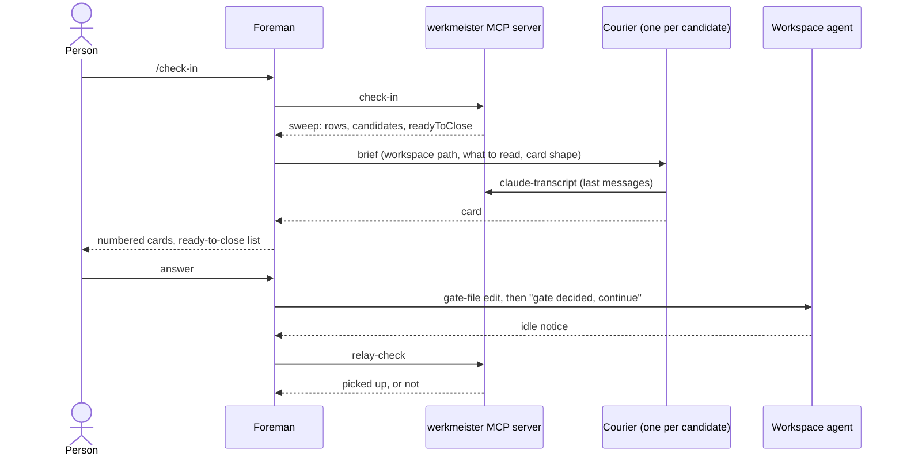

# The foreman's workspace

Werkmeister means works foreman: the person in charge of a workshop floor. This page uses that name for the agent that runs the floor.

| Term | Means |
|---|---|
| **Foreman** | The agent session started in the folder that holds all the workspaces. It routes, checks on the workspace agents and carries answers. It does no ticket work itself. Older docs and the plugin call it "the root session". |
| **Foreman's workspace** | That folder (`werkmeister workspace list` prints it as the root). Each subfolder is one workspace. The folder's own `CLAUDE.md` only routes; it holds no task content. |
| **Workspace agent** | The agent working one ticket inside one workspace. |
| **Courier** | A short-lived, read-only subagent the foreman sends into one workspace. |
| **Card** | The fixed five-line report a courier brings back. |
| **Gate file** | A stage output or PR file in a workspace whose status line waits on a person. See [Check-in](workspace-lifecycle.md#check-in). |

The foreman keeps one rule: workspace content stays in its workspace. The foreman never reads a workspace's stages, code or transcript into its own context. Everything it knows about a workspace arrives as a status row or a card.

## The courier pattern

The courier pattern is how the foreman finds out which workspace agents are waiting on a person, and how the person's answer gets back to them. It runs when the person types `/check-in` in the foreman's session. The steps live in the plugin's skill, `plugins/werkmeister/skills/check-in/SKILL.md`.

### Why it exists

A person running several workspaces at once has several agents that stop and wait: on a question, on a gate file, on a merge. Reading each workspace to find out what it wants would fill the foreman's context with every ticket's detail, and the foreman would then mix them up or run out of room.

So the foreman reads nothing itself. It sends one courier per workspace. Each courier reads a small, fixed set of files, returns a card and ends. The courier's context is thrown away; the foreman keeps only the card.

### The four steps



**1. Triage.** The foreman calls the `check-in` MCP tool once. The server sweeps every workspace and returns JSON: one row per workspace, the names that need a courier (`candidates`) and the names that are ready to close (`readyToClose`). The foreman reads no workspace files in this step. In the same turn it asks Claude Code which sessions are live, so it knows later how to reach each workspace.

**2. Couriers.** The foreman starts one read-only subagent per candidate, all in one message so they run at the same time. Each gets the same brief, word for word, with only the workspace path changed.

**3. Queue.** The foreman prints the cards that need a person, numbered, then the ready-to-close list. Then it waits for the person. It reads nothing else.

**4. Relay.** The foreman carries each answer back through one of the [relay channels](#relay-channels).

### How the sweep picks candidates

The sweep is `packages/werkmeister-core/src/sandbox.ts::checkInTriage`. It does three things besides reporting:

- **Filters by label.** A workspace labelled `skip` is dropped. When any workspace is labelled `focus`, only those are kept. Labels are the `labels` list in a workspace's `.werkmeister/workspace.yml`.
- **Ships merged PRs.** A merged PR whose release tag now exists moves to shipped, as described in [Check-in](workspace-lifecycle.md#check-in).
- **Marks the time.** It touches `.check-in-last` in the foreman's workspace. The next sweep reports a workspace as `changed` only when its transcript moved after that mark. This is why the skill calls the tool once per run.

A kept workspace is a candidate when all of these hold:

- it is not paused,
- its agent is not working (no turn running, no test, tool call or subagent in progress),
- it is not already on the ready-to-close list,
- and one of:
  - its needs list has an item a courier can carry: a question, a permission, a plan or a handed-over gate (`COURIER_KINDS` in the same file),
  - its transcript changed since the last check-in,
  - on a first run with no mark: its agent finished and spoke last.

Other needs (a failed CI run, a merge conflict, a requested change, a merge) are never courier work. They need the person in that workspace.

A gate counts only once the workspace agent has handed it over. An agent that is still busy, holds a background shell or runs autonomously has not handed its gate over, even if the file already reads `status: proposed`.

### What a courier reads

A courier is a Claude Code `Explore` subagent, which cannot edit files. Its brief limits it to:

| Reads | To learn |
|---|---|
| the workspace's `CLAUDE.md` | the routing table, so it can name the current stage |
| the listing of `stages/*/output` | which stage is current: the first one with an empty `output/` |
| the first 15 lines of each gate file | what is waiting for approval |
| the last 8 messages, through the `claude-transcript` MCP tool | what the workspace agent last asked |

It is told not to open the code worktrees, `_shared/`, `.werkmeister/` or the stage contracts.

### The card

A courier returns exactly this and nothing else:

```
## <ws> — stage <NN_name or done> — claude <idle|working>
needs a person: yes|no
question: <the last assistant message's ask, verbatim, ≤5 lines; or "none">
gate: <path of the `status: proposed` or `status: draft` file, or none>
suggested answer: <one line, or "—">
```

`needs a person` is `yes` only when the last assistant message asks something, ends on a choice, or a gate file is waiting. The fixed shape is the point: the foreman can hold many cards cheaply, and a card never drags a workspace's reasoning along with it.

The foreman corrects one thing. A card that says `yes` only because of a gate reads `no` when the sweep shows no handed-over gate for that workspace. The courier sees the file; only the sweep knows whether the agent has let go of it.

### Relay channels

The foreman picks the channel by what the workspace is waiting on and whether a session for it is live.

| Channel | Used when | What happens |
|---|---|---|
| **The person, in that session** | The workspace waits on an approval no gate file holds: a commit, a push, a PR merge, a gated live run, a post-mortem answer, an open question box | Nothing is relayed. The foreman tells the person what to type and in which session. |
| **Gate file** | The answer approves a gate file | The foreman edits the status line to carry the approval and a check-in note, then sends "gate decided, continue" through one of the two channels below. |
| **Live session** | A desktop or terminal session for the workspace is running | The foreman sends the message to that session with Claude Code's `SendMessage`. It runs there as a turn. When the session goes idle a notice comes back, and the foreman calls the `relay-check` MCP tool to confirm. |
| **Headless** | No live session, and the answer needs no new permissions | The `claude-send` MCP tool runs one turn of the workspace's session in the background. The `claude-turn-status` MCP tool reports when it finished. |
| **Interactive terminal** | No live session, and the answer leads to commands that need permission prompts | The `claude-resume` MCP tool opens the session in a terminal with the answer as its first message. The person approves prompts there. |
| **Close out** | The person says yes to a ready-to-close workspace | The `close-out` MCP tool removes it, one workspace at a time. |

### Why an approval is a file edit

A workspace agent cannot see who sent a message. A message from the foreman that says "approved" looks the same as one from any other session, so the agent is told not to take a peer message as the person's approval.

The gate file solves this. When the person approves at check-in, the foreman changes the gate's status line itself:

```
status: decided (approved via check-in YYYY-MM-DD)
```

or, in a PR file:

```
status: approved  # approved via check-in YYYY-MM-DD
```

Then it sends only "gate decided, continue: re-read the file". The message claims nothing. The workspace agent re-reads the file, finds the note and acts on it, so the person answers once. A flipped status with no check-in note is not an approval: the agent leaves the file alone and asks the person. The agent's side of this rule is `packages/werkmeister-core/src/pr_rules.ts::CHAT_APPROVAL`.

Only the `check-in` skill and the workspaces pane edit another workspace's gate file, and only on the person's answer in that turn.

### What can go wrong

| Case | What the foreman does |
|---|---|
| The message was sent but never ran | A hook in the receiving session can drop a prompt, and the idle notice then quotes an older reply. The `relay-check` MCP tool looks for the message as a user turn in the transcript after the send time. When it is missing, the foreman reports "not picked up" with the line to type, and does not send again. |
| The workspace has a turn running | The foreman never sends to it. It shows up at the next check-in. |
| A headless turn needs a permission | A headless turn cannot show a permission prompt, so the action fails and the agent replies "run this yourself". Use the interactive terminal channel for answers that lead to commands. |
| The session holds the gate in an open question box | The relayed message waits behind the box. The person dismisses the box in that session; the file already holds the answer. |
| The session already refused a relayed answer | The foreman does not retry. The person answers in that session. |

### What is specific to Claude Code

The pattern itself is general: a coordinator sends scoped, read-only workers that return a fixed report, and decisions travel as files. These parts of werkmeister's version depend on Claude Code:

| Part | Depends on |
|---|---|
| The steps the foreman follows | a Claude Code skill in the werkmeister plugin |
| Couriers | Claude Code subagents (the `Explore` type) |
| Finding and messaging live sessions | Claude Code's `ListAgents` and `SendMessage`, and `list_sessions` from the desktop app |
| Transcript reads, headless sends, terminal resume | the Claude tools in `apps/werkmeister-mcp/src/harness/claude/tools.ts`, which read Claude Code's session files and run its CLI |

These parts do not: the sweep (`checkInTriage` is in the SDK), the gate-file protocol, and the MCP server as a transport. For other harnesses see [Harnesses](harnesses.md).
