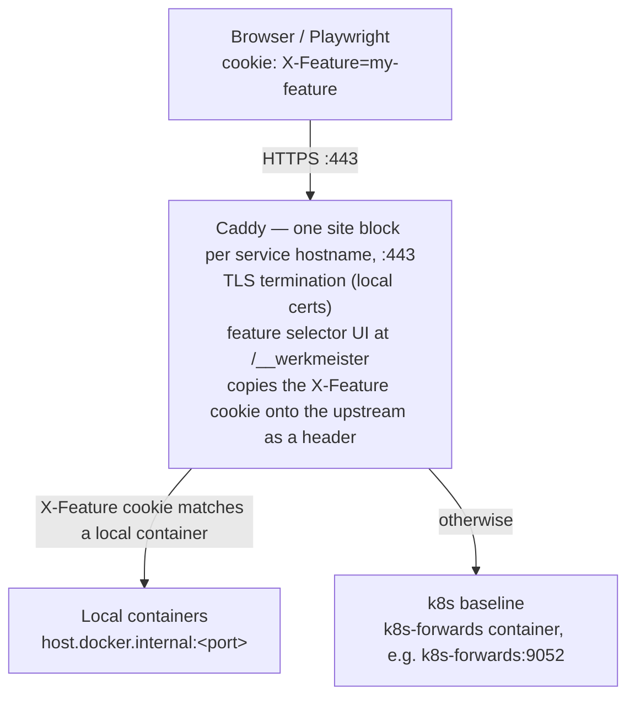

# Werkmeister Architecture

## Multi-Feature Concurrent Development for Distributed Application

---

## Overview

A system that lets many Claude Code agents develop features at once across a multi-service application on one machine. Each feature runs only the services it changes; everything else comes from k8s. So the number of features you can run at once depends on how many services you run locally and how much RAM you have. The default is 12 slots (`feature_slots.count`), and you can raise it. A reverse proxy routes traffic per-feature using HTTP headers/cookies.

---

## Core Design Principles

1. **Minimal local footprint** — only run containers for services with code changes; everything else comes from k8s via `kubectl port-forward`.
2. **Feature isolation** — each feature gets its own Docker network, port range, and routing identity. No cross-contamination.
3. **Auto-detection** — the system infers which services to run locally by analyzing which repos/worktrees have changes.
4. **Shared state** — a single shared dev database and Redis, served from the cluster through the forward table. No per-feature data isolation needed.
5. **Cookie-driven routing** — Caddy terminates each service's public hostname and resolves feature-vs-k8s per request from the `X-Feature` cookie, copying it onto the upstream call as a header so the app can read the selected feature.

---

## System Architecture

For which *machine* each of these runs on — laptop, container runtime, or a cloud
cluster — see [docs/topology.md](topology.md). This section is the request path.



<details>
<summary>Diagram source</summary>



</details>

All services communicate via Docker DNS on the werkmeister-shared network.
Local feature containers are reached from Caddy via `host.docker.internal:<port>`.
k8s services are reached via the k8s-forwards container (e.g., `k8s-forwards:9052`).

---

## Component Details

### 1. Reverse Proxy (Caddy)

**Why Caddy**: native header/cookie matching, automatic config reload, simple config syntax, lightweight, built-in TLS support.

**Role**: Caddy is the browser-facing entry point and the only routing layer. It terminates HTTPS, serves the feature selector UI, and reverse-proxies each service's public hostname straight to its upstream — the feature's local container when one is running, otherwise the k8s baseline.

**What Caddy does**:
- Terminates HTTPS/TLS using local certificates (mounted from the directory named by `ingress.certs_dir` in `~/.werkmeister/config.yaml`).
- Serves the feature selector UI at `/__werkmeister` on every host (`/__sandbox` is a deprecated alias) — a static page that lets the user pick a feature and sets the `X-Feature` cookie client-side. `/__werkmeister/features.json` is matched first (a real file); any other `/__werkmeister` path returns the picker.
- Copies an `X-Feature` cookie value into an `X-Feature` header on the upstream call, so the app can read the selected feature.
- Proxies to `host.docker.internal:<port>` for a local feature container, or to `k8s-<service>:<forward_port>` for the k8s baseline.

**Caddyfile generation**: the orchestrator CLI regenerates the Caddyfile whenever a feature is started or stopped (`werkmeister proxy-reload`, and implicitly on `up`/`down`/`connect`). The file carries a do-not-edit header; hostnames derive from the base domains in `~/.werkmeister/config.yaml` and the `feature_router:` blocks in `services.yaml` (see `packages/werkmeister-core/src/feature_routing.ts`).

```
# Example generated Caddyfile snippet
frontend.remote.werkmeister.io {
    tls internal

    # Feature selector UI
    @selector_features path /__werkmeister/features.json /__sandbox/features.json
    handle @selector_features {
        root * /srv
        rewrite * /features.json
        file_server
    }
    @selector path /__werkmeister* /__sandbox*
    handle @selector {
        root * /sandbox/proxy/ui
        rewrite * /index.html
        file_server
    }

    # Cookie present -> copy its value into an X-Feature header, then proxy.
    @xf header_regexp xf Cookie X-Feature=([^;]+)
    handle @xf {
        reverse_proxy k8s-frontend:9053 {
            header_up X-Feature {re.xf.1}
        }
    }
}
```

A feature only gets a match block for a service it actually runs locally, so
per-service granularity is preserved: one service can come from the local
container while its siblings still resolve to the k8s baseline.

### 2. Port Allocation Scheme

Each feature slot (1–12) gets a port range. Deterministic, no collisions.

| Slot | Feature Port Range | Usage |
|------|-------------------|-------|
| 1    | 11100–11119       | Up to 20 service ports |
| 2    | 11200–11219       | |
| 3    | 11300–11319       | |
| ...  | ...               | |
| 12   | 12200–12219       | |

**k8s port-forwards** run inside the `k8s-forwards` container and are accessible via Docker DNS (e.g., `k8s-forwards:9052`). Host ports are also exposed for debugging:

| Listen Port | k8s Service | Docker DNS Alias |
|-------------|-------------|------------------|
| 9050 | redis | `k8s-redis` |
| 9051 | postgres | `k8s-postgres` |
| 9052 | backend | `k8s-backend` |
| 9053 | frontend | `k8s-frontend` |

**Shared infrastructure** (not k8s -- runs locally as containers):

| Service | Docker DNS | Port |
|---------|-----------|------|
| Jaeger (tracing UI), opt-in | `jaeger` | 16686 |
| RedisInsight, opt-in | `redisinsight` | 5540 |

Jaeger and RedisInsight start only when `infra.profiles` in `~/.werkmeister/config.yaml` names them (see [third-party.md](third-party.md#optional-integrations)).

Redis and Postgres themselves run in the k8s cluster and are reached through the
forward table above, not as compose services. The containers listed here are defined
in `infra/compose/shared-infra.yml` and managed by Docker Compose.

### 3. Service Registry & Auto-Detection

A central config maps repos → services → Docker compose files:

```yaml
# ~/.werkmeister/services.yaml
repos:
  demo-services:
    services: [backend, frontend]
    path_mappings:
      apps/backend: backend
      apps/frontend: frontend

services:
  backend:
    repo: demo-services
    path: apps/backend
    type: api
    internal_port: 3000
    port_offset: 0          # within the feature's port range
    health_endpoint: /health
    k8s_deployment: backend
    k8s_namespace: default
    k8s_port: 80
    k8s_forward_port: 9052

  frontend:
    repo: demo-services
    path: apps/frontend
    type: web
    internal_port: 3000
    port_offset: 1
    health_endpoint: /
    archetype: node-web
    k8s_deployment: frontend
    k8s_namespace: default
    k8s_port: 8080
    k8s_forward_port: 9053
```

**Auto-detection algorithm**:

```
For a given feature workspace:
  1. List all worktree directories in the workspace
  2. For each worktree, identify the repo name
  3. Run `git diff main..HEAD --name-only` in each worktree
  4. Map changed file paths → services using services.yaml path mappings
  5. Result: set of services that need to run locally
  6. Everything else: use k8s port-forward
```

**Re-detection triggers**:
- On `werkmeister up` (initial)
- On Vibe Kanban status change (e.g., moving to "in review")
- Optionally: file watcher that re-detects when new files are committed

### 4. Orchestrator CLI (`werkmeister`)

The core tool that agents and developers invoke.

```bash
# Lifecycle
werkmeister up <feature>         # detect services, start containers, configure proxy
werkmeister down <feature>        # stop containers, remove proxy routes
werkmeister restart <feature>     # restart feature's containers
werkmeister status               # show all features, their services, resource usage

# Inspection
werkmeister detect [repo]        # generate the repo's .werkmeister/services.yaml (--dry-run to preview)
werkmeister services <feature>   # list services and their endpoints for this feature
werkmeister logs <feature> [svc] # tail logs for a feature's service

# Manual overrides (to run a service locally: add it to .werkmeister/workspace.yml, then init-workspace + up)
werkmeister remove <feature> <svc> # stop a local service, fall back to k8s

# Testing
werkmeister test <feature>       # run Playwright against this feature's stack

# Infrastructure
werkmeister up infra             # start shared infrastructure (k8s-forwards, caddy; jaeger, redisinsight if enabled)
werkmeister status --k8s         # check k8s-forwards container health
werkmeister proxy-reload         # regenerate Caddyfile and reload Caddy
```

**Implementation**: A TypeScript CLI that lives in the Werkmeister repo. Each command is a module in `apps/cli/src/commands/`.

### 5. Per-Feature Docker Compose Generation

When `werkmeister up <feature>` runs, it dynamically generates the workspace's `compose.yml`:

```yaml
# Auto-generated for feature: payment-refactor
# Services detected: frontend, backend

networks:
  feature-payment-refactor:
    name: sandbox-payment-refactor
  werkmeister-shared:
    external: true

services:
  frontend:
    build:
      context: /Users/dev/workspaces/payment-refactor/demo-services
      dockerfile: apps/frontend/Dockerfile
      target: development     # use dev stage for hot-reload
    ports:
      - "11101:3000"
    environment:
      - BACKEND_URL=http://backend:3000            # local (same feature)
      - REDIS_URL=redis://k8s-redis:9050                 # k8s baseline
      - DATABASE_URL=postgresql://postgres:5432/dev  # shared infra
    volumes:
      - /Users/dev/workspaces/payment-refactor/demo-services/apps/frontend/src:/app/src
    networks:
      feature-payment-refactor:
        aliases:
          - frontend
      werkmeister-shared:
        aliases:
          - frontend

  backend:
    build:
      context: /Users/dev/workspaces/payment-refactor/demo-services
      dockerfile: apps/backend/Dockerfile
      target: development
    ports:
      - "11101:4000"
    environment:
      - GRAPHQL_GATEWAY_URL=http://k8s-forwards:9004     # k8s baseline
      - REDIS_URL=redis://redis:6379                     # shared infra
      - DATABASE_URL=postgresql://postgres:5432/dev  # shared infra
    volumes:
      - /Users/dev/workspaces/payment-refactor/demo-services/apps/backend/src:/app/src
    networks:
      feature-payment-refactor:
        aliases:
          - backend
      werkmeister-shared:
        aliases:
          - backend
```

**Key design choices**:
- Docker DNS aliases on the `werkmeister-shared` network to reach all services -- no `host.docker.internal` anywhere.
- Local services (same feature): referenced by Docker DNS name (e.g., `http://backend:3000`). The env-var name is the service name upper-cased with `-` → `_`, plus `_URL`.
- k8s baseline services: reached via the `k8s-forwards` container (e.g., `http://k8s-forwards:9052`).
- Shared infrastructure: Redis at `redis://k8s-redis:9050`, Postgres at `postgresql://k8s-postgres:9051/dev`.
- Feature containers join both the per-feature network (isolation) and the `werkmeister-shared` network (access to shared infra and k8s forwards).
- Volume mounts for hot-reload of source code from the worktree.
- Environment variables are generated per-service, mixing local and k8s endpoints using Docker DNS names.

### 6. GraphQL Federation (optional)

Applies only when the registry has a service with a GraphQL type (`graphql-subgraph`, `graphql`, `subgraph`, `federation`). Without one, no supergraph config is generated.

The gateway needs to know where each subgraph lives. Since subgraph locations vary per feature (some local, some k8s), the config must be per-feature.

**Approach**: Generate a `supergraph-config.yaml` per feature and mount it into the gateway container (or the k8s gateway if the gateway itself isn't running locally). All URLs use Docker DNS names on the `werkmeister-shared` network.

```yaml
# Auto-generated: supergraph-config.payment-refactor.yaml
subgraphs:
  inventory:
    routing_url: http://k8s-forwards:9005            # k8s baseline
    schema:
      subgraph_url: http://k8s-forwards:9005
  orders:
    routing_url: http://orders-subgraph:4000        # LOCAL (Docker DNS)
    schema:
      subgraph_url: http://orders-subgraph:4000
  users:
    routing_url: http://k8s-forwards:9006            # k8s baseline
    schema:
      subgraph_url: http://k8s-forwards:9006
```

If the gateway itself runs on k8s (not locally), the feature's local services would need to be exposed via a tunnel (e.g., `ngrok`) so k8s can reach them. **Recommendation**: always run the gateway locally per-feature if any subgraph is local -- it's lightweight and avoids tunneling complexity.

### 7. k8s Port-Forward Manager (Containerized)

All k8s port-forwards run inside a single Docker container (`k8s-forwards`) rather than as host-level background processes. This simplifies lifecycle management, networking, and health monitoring.

**Container details**:
- Built from `infra/compose/k8s-port-forward/Dockerfile` (based on a digest-pinned `alpine`).
- Installs `kubectl`, `bash`, `netcat-openbsd`, `redis` and `postgresql-client` for port-forwarding and health probes. No cloud-provider auth plugin is needed — the cluster authenticates via the client cert embedded in the mounted kubeconfig.
- Entrypoint script (`infra/compose/k8s-port-forward/entrypoint.sh`) runs all port-forwards as background processes with auto-restart loops.
- Mounts `~/.kube` (read-only) and the generated kubeconfig for `kubectl` authentication.

**Networking**:
- Connected to the `werkmeister-shared` Docker network.
- Registers DNS aliases for each forwarded service (e.g., `k8s-backend`, `k8s-frontend`, `k8s-redis`, `k8s-postgres`).
- The primary alias `k8s-forwards` is the canonical name used by other containers.
- Each forward listens on `0.0.0.0:<listen_port>` so it is reachable from any container on the shared network.

**Port mappings** (inside the `k8s-forwards` container):

| Listen Port | k8s Service | Namespace | Remote Port |
|-------------|-------------|-----------|-------------|
| 9050 | redis | default | 6379 |
| 9051 | postgres | default | 5432 |
| 9052 | backend | default | 80 |
| 9053 | frontend | default | 8080 |

**Health checks**: Docker Compose healthcheck runs `/usr/local/bin/probe.sh` (`infra/compose/k8s-port-forward/probe.sh`). The container reports healthy only when the critical forwards are established. Other containers (e.g., `redisinsight`) use `depends_on: k8s-forwards: condition: service_started` to wait.

**Lifecycle**: Managed entirely by Docker Compose. Auto-restarts on failure (`restart: unless-stopped`). Logs are accessible via `docker logs w9r-k8s-forwards`. The `werkmeister status --k8s` command checks the container's health status.

### 8. Playwright Integration

Each feature can run its full Playwright test suite against its own isolated stack.

**Setup**:
```javascript
// playwright.config.ts — generated or parameterized per feature
export default defineConfig({
  use: {
    baseURL: 'https://frontend.local.werkmeister.io',
    extraHTTPHeaders: {
      'X-Feature': process.env.SANDBOX_FEATURE || 'default',
    },
  },
});
```

**Execution**:
```bash
werkmeister test payment-refactor
# Equivalent to:
# SANDBOX_FEATURE=payment-refactor npx playwright test
```

Caddy reads the `X-Feature` cookie/header and routes to the correct containers. Playwright hits the same service URL every feature uses -- only the header differs.

**Header propagation for API calls from the browser**: The web app needs to forward the `X-Feature` cookie/header on its API calls. Options:
- The reverse proxy injects the header on all proxied requests based on the cookie (simplest — Caddy handles this).
- The web app reads the cookie and includes it in fetch headers (requires a small code change, but more explicit).

**Recommendation**: Have Caddy inject the header. Zero code changes to the application.

---

## Routing applies only to front-door services

Caddy routing, the `X-Feature` cookie, the proxy health checks and the Playwright feature test apply only to services with a `feature_router:` block. Libraries, CLIs and editor extensions are not reached by URL, so none of that exercises them. `.werkmeister/sandbox-context.md` always carries a "How to validate" table with each of the workspace's services and its test command, plus the service's `validate:` text (or its archetype's). It emits the routing, Caddy and health-check sections only when the workspace has a URL-addressed service. `werkmeister test` runs Playwright only when the workspace has a `playwright.config.*`. `test:` is the command tooling runs (the implement stage, the PR gate); `validate:` is the hands-on check an agent or person performs, recorded as the exercise table the gate requires. See [Test commands and validation guidance](users-guide.md#test-commands-and-validation-guidance).

## Directory Structure

```
~/werkmeister/                          # werkmeister repo
├── apps/cli/werkmeister                 # CLI entrypoint (bash wrapper -> node)
├── apps/cli/src/               # CLI source
│   ├── main.ts
│   └── commands/                       # one module per command (up.ts, down.ts, ...)
├── apps/cli/infra/compose/             # Docker Compose files
│   ├── shared-infra.yml                # Shared infrastructure (k8s-forwards, caddy,
│   │                                   #   opt-in jaeger, redisinsight)
│   └── k8s-port-forward/               # Containerized k8s port-forwards
│       ├── Dockerfile                  # Based on alpine (kubectl only)
│       ├── entrypoint.sh              # Port-forward supervisor script
│       └── probe.sh                    # Healthcheck
├── apps/cli/infra/templates/
│   ├── docker-compose.feature.yml.njk  # nunjucks template for per-feature compose
│   ├── Caddyfile.njk                   # Template for proxy config
│   └── supergraph-config.yml.njk       # Template for the optional GraphQL gateway
├── apps/cli/infra/proxy/ui/            # Feature selector web UI
│   └── index.html
└── docs/
    ├── users-guide.md
    └── known-issues.md

~/.werkmeister/                         # machine config + generated state
├── config.yaml, services.yaml, ports.yaml
└── infra/proxy/
    ├── Caddyfile                       # Generated — do not edit
    └── features.json                   # Generated feature list for UI

~/workspaces/                           # Vibe Kanban workspaces
├── payment-refactor/
│   ├── compose.yml              # Generated per-feature compose stack
│   ├── .env                            # Generated resolved env vars
│   ├── .werkmeister/
│   │   └── supergraph-config.yml       # Generated only when a GraphQL subgraph exists
│   ├── demo-services/                  # git worktree
│   └── api/                            # git worktree
├── auth-redesign/
│   ├── compose.yml
│   ├── .env
│   ├── .werkmeister/
│   │   └── supergraph-config.yml
│   ├── werkmeister/
│   └── standalone-auth/
└── ...
```

---

## Lifecycle: `werkmeister up payment-refactor`

```
1. DETECT
   ├── Scan ~/workspaces/payment-refactor/ for worktrees
   ├── For each worktree: git diff main..HEAD --name-only
   ├── Map changed paths → services via services.yaml
   └── Result: [frontend, backend]

2. ALLOCATE
   ├── Find next available feature slot (e.g., slot 3)
   ├── Assign port range 11300–11319
   └── Slot is recorded as a container label (com.werkmeister.slot) on compose up

3. GENERATE
   ├── Render docker-compose from template with:
   │   ├── Local services: frontend → 11300, backend → 11301
   │   ├── k8s services: all others → their 9xxx ports
   │   └── Volume mounts pointing at worktree paths
   ├── Render supergraph-config.yml (only if the registry has a GraphQL subgraph)
   └── Render .env file with all service URLs

4. VERIFY k8s
   ├── Check that k8s-forwards container is healthy (docker inspect --format)
   └── If unhealthy/stopped: restart via docker compose -f infra/compose/shared-infra.yml up -d k8s-forwards

5. START CONTAINERS
   ├── docker compose -f ~/workspaces/payment-refactor/compose.yml up -d
   └── Wait for health checks

6. CONFIGURE PROXY
   ├── Regenerate Caddyfile with new feature routes
   └── Caddy hot-reloads Caddyfile changes automatically

7. REPORT
   └── Print feature URL, service endpoints, and status
       "✓ payment-refactor ready at https://frontend.local.werkmeister.io (cookie: X-Feature=payment-refactor)"
       "  Local:  frontend (:11300), backend (:11301)"
       "  k8s:    api (:9004), redis (:9050), ..."
```

---

## Resource Estimation

Two budgets, not one. Containers share the memory you gave Docker (OrbStack or
Docker Desktop → Resources), and that allocation fills long before the machine
does. Agents, browsers and your editor use the rest.

**Inside the Docker allocation**

| What | Each | Note |
|---|---|---|
| A local service | ~0.5 GB | a Node service with hot reload; a JVM or a database is more |
| Caddy | ~20 MB | measured |
| `k8s-forwards` | ~65–250 MB | measured idle; grows with forwards |
| Docker daemon | ~0.5 GB | |

**Outside it**

| What | Each | Note |
|---|---|---|
| A Claude Code agent | ~0.25 GB per process, 2–3 processes per session | 245 MB per process measured 2026-10-25 |
| A Playwright run | ~0.5–1 GB | one Chromium |

**Worked example: 6 features, 2 local services each**

- containers: 12 × 0.5 GB = 6 GB, + ~0.6 GB shared → ~7 GB of the Docker allocation
- agents: 6 × ~0.6 GB → ~3.6 GB
- browsers: 2 Playwright runs → ~1.5 GB
- total ≈ 12 GB plus the OS and your editor. On a 32 GB machine with 12 GB given to Docker, the first thing to run out is the Docker allocation, at about ten more local services.

**Measured:** 5 features × 3 local services on a 32 GB machine = 15 GB (2026-10-26).

The number of features is whatever fits: raise the Docker allocation or run fewer services per feature before you touch `feature_slots.count`.

---

## Vibe Kanban Integration

### Workspace Hooks

In each Vibe Kanban workspace, add a hook in the Werkmeister repo worktree:

```bash
# .vibe/hooks/on-status-change.sh
#!/bin/bash
FEATURE="$VIBE_FEATURE_NAME"
STATUS="$VIBE_NEW_STATUS"

case "$STATUS" in
  "in-progress")
    werkmeister up "$FEATURE"
    ;;
  "in-review")
    werkmeister test "$FEATURE"
    ;;
  "done"|"cancelled")
    werkmeister down "$FEATURE"
    ;;
esac
```

### Claude Code Agent Integration

Each Claude Code agent operates in its own workspace and can invoke `werkmeister` commands:

```bash
# Agent starting work on a feature
werkmeister up payment-refactor

# Agent wants to check its work
werkmeister test payment-refactor

# Agent adds a service it now needs (after listing graphql-orders in .werkmeister/workspace.yml)
werkmeister init-workspace
werkmeister up payment-refactor

# Agent checks what's running
werkmeister status
```

---

## Open Decisions

1. ~~**CLI language**~~ — **settled**: TypeScript on Node ≥20, with nunjucks for template rendering and the `yaml` package for generation. Commander owns argument parsing.

2. **Hot-reload strategy**: Volume-mount source into dev-stage containers (recommended for speed) vs. rebuild on change (simpler Dockerfiles)?

3. **Database migrations**: With 12 agents sharing one database, how do you handle schema changes? Options:
   - Schema changes only allowed on one feature at a time (serialized via a lock)
   - Each feature uses a prefixed schema (`payment_refactor_*`) — high code impact
   - Feature flags in migrations — most flexible but complex
   - **Recommended**: treat migration conflicts like merge conflicts — handle at review time

4. **Proxy header propagation**: Should web apps explicitly forward `X-Feature`, or should Caddy inject it on all proxied traffic? Caddy injection is simpler but the header wouldn't survive if a service makes an outbound call that doesn't go through the proxy.

5. **Playwright parallelism**: Can every running feature run Playwright tests simultaneously, or is that too resource-heavy? May need a queue.
