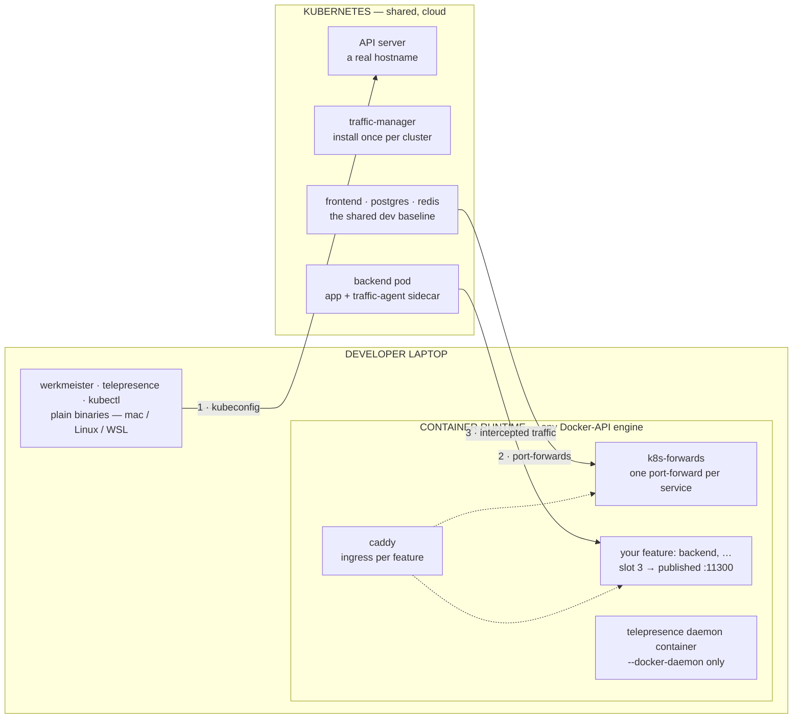
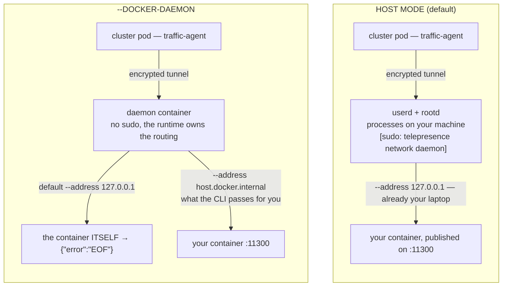

# Topology: where each piece runs

Which machine, and which container, every part of Werkmeister lives in — and what
crosses the boundary between your laptop and the cluster.

The short version: **containers are local, Kubernetes is remote, and telepresence
is the only piece that can sit on either side.** That last choice is
`werkmeister intercept --docker-daemon`, and it is the only decision in this document.
Without a cluster, the same shape holds with a baseline container in `w9r-infra`
or a manual tunnel standing in for `k8s-forwards`; see *Without Kubernetes*.

---

## The intended shape



<details>
<summary>Diagram source</summary>



</details>

Only three things cross the boundary:

1. **The kubeconfig** — how the CLI, `kubectl` and telepresence authenticate.
2. **Port-forwards** — one per cluster service you are *not* running locally,
   held open by the `k8s-forwards` container.
3. **Intercepted traffic** — during an intercept only, header-matched requests
   leaving the traffic-agent and arriving at your local container.

Everything else is local: compose builds, Caddy routing, file watching, tests,
and the whole edit loop.

The container runtime is the developer's own choice. Werkmeister speaks only the
Docker API, and `infra/compose/shared-infra.yml` maps
`host.docker.internal:host-gateway` — the portable form — so plain `dockerd` on
Linux behaves like Docker Desktop or OrbStack on a Mac.

---

## What actually needs the cluster

| Command | Cluster | Talks to |
|---|---|---|
| `up` · `down` · `restart` | no | docker compose |
| `status` · `logs` · `test` · `open` | no | container state, published ports |
| `workspace` · `list-workspaces` | no | git worktrees on disk |
| `connect` | for forwards | starts `k8s-forwards`, one `kubectl port-forward` per service |
| Caddy fallback routes | for services you don't run | the `k8s-*` upstreams that container exposes |
| `intercept` | required | traffic-manager + a traffic-agent; refused unless the service declares `k8s_deployment`, `k8s_namespace` and `k8s_port` |

A registry whose services declare no `k8s_forward_port` yields an empty forward
table rather than an error — the shape a fully self-hosted registry
assumes, where nothing runs in a cluster at all and telepresence never enters the
picture.

---

## Where telepresence runs

The binary is always on the host. What moves is its two daemons.

**Host mode (the default).** Two processes on your machine:

```
you   telepresence userd  --config .../config.yml
root  telepresence rootd  --cache ~/Library/Caches/telepresence
root  sudo -b -p [sudo: telepresence network daemon] Password:
```

That third line is the password prompt people ask about. It is telepresence's own
`sudo`, not Werkmeister's: root is needed for a TUN device, `/etc/resolver/*` and
the routing table. It comes **once per root-daemon lifetime** — until
`telepresence quit -s` or a reboot — not once per intercept.

**Docker mode (`--docker-daemon`).** Both daemons in one container, on a network
telepresence creates. Nothing telepresence-related runs on the host, so nothing
asks for a password.



<details>
<summary>Diagram source</summary>



</details>

The right-hand fork is the one thing docker mode gets wrong on its own, so the
CLI passes `--address host.docker.internal` whenever `--docker-daemon` is set
(`buildInterceptArgs` in `packages/werkmeister-core/src/telepresence.ts`). Host mode's
`127.0.0.1` default already names the right machine and is left alone.

| | host mode | `--docker-daemon` |
|---|---|---|
| Password prompt | yes, per root-daemon lifetime | no |
| `backend.default` resolves on the laptop | yes | **no** |
| Host routing table | shared with your VPN | untouched |
| Needs a working Docker | only for your services | for the daemon too |

Pick host mode when you want to `curl` cluster hostnames from your own shell.
Pick `--docker-daemon` when a VPN is fighting the routing table, or when the
password prompt is in the way. Traffic flowing cluster → laptop is identical
either way. Switching modes means `telepresence quit -s` first.

---

## Running against a cloud cluster

Most of it is already handled:

- The forwards container is fed `kubectl config view --raw --minify --flatten`,
  so certificates and tokens are **inlined**, not left as host paths the
  container cannot see.
- `shimLocalApiServer` (`packages/werkmeister-core/src/k8s.ts`) rewrites a
  `127.0.0.1` API address to `host.docker.internal` and drops CA verification —
  and no-ops for a remote cluster, which needs neither. Telepresence's docker
  mode does the same rewrite for the same reason. A local cluster is the special
  case here, not the cloud one.

**Check first: `exec` credential plugins.** Managed clusters usually authenticate
through one — `aws eks get-token`, `gke-gcloud-auth-plugin`, `az`, an OIDC
helper. That stanza survives `--flatten` as a command the *container* is then
expected to run, and the `k8s-forwards` image
(`infra/compose/k8s-port-forward/Dockerfile`) ships `kubectl`, a shell and probe clients, but no auth plugin.

- Host side: fine. Your `kubectl`, and telepresence in host mode, run where the
  plugin and its credentials already live.
- Containerized side: the forwards image, and telepresence's daemon container
  under `--docker-daemon`. Either bake the plugin and its credentials in, or
  issue those two a long-lived token or client certificate instead.

Also worth knowing, none of it blocking:

- **The traffic-manager is per cluster.** Install it once in the cloud cluster
  before the first intercept. Nothing else in Werkmeister needs anything
  installed there.
- **Intercepted requests cross the internet** — cluster to laptop and back on
  every matched request. Fine for a debug loop, visible in a latency-sensitive
  test.
- **A private API endpoint means a VPN**, which is exactly what host mode's TUN
  device tends to fight over. This is the strongest argument for
  `--docker-daemon` in a real deployment: the daemon container egresses through
  the host, so the VPN still carries it, but the host's own routing table is
  left alone.

## Without Kubernetes

Nothing above needs a cluster except the forwards and the intercepts, and only
the intercepts have no stand-in. What holds today, checked against the code:

1. **The forward table is empty.** A service with no `k8s_forward_port` gets no
   forward (`forwardSpecs`, `packages/werkmeister-core/src/config.ts`), so
   `k8s-forwards` has nothing to do and the shape collapses to Caddy plus your
   containers.
2. **Browser traffic still has a baseline.** Caddy's no-cookie default for a
   hostname is the service's `feature_router.remote_upstream`, any `host:port`
   (`defaultUpstream` in `packages/werkmeister-core/src/generate.ts`). Set it to
   `host.docker.internal:<port>` and a tunnel held open on the host is the
   baseline. One line each:

   | Where the base service runs | The tunnel |
   |---|---|
   | EC2 | `ssh -L <port>:localhost:<port> ec2-user@<host>`, or `aws ssm start-session --document-name AWS-StartPortForwardingSession` |
   | ECS / Fargate | SSM `AWS-StartPortForwardingSessionToRemoteHost` through a bastion or an ECS Exec task |
   | Cloud Run | `gcloud run services proxy <svc> --port <port>` |
   | A remote Docker host | `ssh -L`, or `DOCKER_HOST=ssh://…` and publish the port |

3. **Container-to-service references follow `baseline_upstream`.** A `{service}`
   reference in a container's environment, and its generated `<SVC>_URL` /
   `_HOST` / `_PORT`, resolve to the service's `baseline_upstream: host:port` in
   `services.yaml` when it is set, ahead of `k8s_forward_port`; a service with
   the key gets no forward (`resolveServiceRefs`, `packages/werkmeister-core/src/generate.ts`).
   Point it at a baseline container (item 5) or any Docker DNS name or remote
   address the containers can reach; not `host.docker.internal`, which only
   Caddy and `k8s-forwards` map.
4. **No intercepts.** Telepresence is Kubernetes-only: `werkmeister intercept`
   needs the traffic-manager and a traffic-agent sidecar, and refuses a service
   without `k8s_deployment`, `k8s_namespace` and `k8s_port`. Remote → laptop by
   header has no equivalent off-cluster. `ssh -R` from the host is the nearest
   stand-in, and it takes the whole port, not one header's worth of requests.
5. **Baseline containers.** `w9r-infra` can run a base service you're not
   changing from its deployed image. Pin the image by digest in
   `~/.werkmeister/config.yaml` and point the service's `baseline_upstream` at
   the container's `baseline-<service>` alias:

   ```yaml
   # ~/.werkmeister/config.yaml
   infra:
     baseline:
       backend:
         image: ghcr.io/acme/backend@sha256:<digest>   # docker inspect --format='{{index .RepoDigests 0}}' <image>:<tag>
         environment: { DATABASE_URL: "postgres://…" } # optional

   # ~/.werkmeister/services.yaml
   services:
     backend:
       baseline_upstream: "baseline-backend:3000"      # the service's internal_port
   ```

   `werkmeister connect` writes them into a generated `baseline.override.yml`
   and starts `w9r-baseline-<service>` on the shared network; a tag-only image
   is refused. No host port is published: set `feature_router.remote_upstream`
   to the same alias to make it the browser's no-cookie default too. Removing
   an entry leaves its container running until `werkmeister down infra`.

### The local-cluster variant

A cluster on the same machine (OrbStack's built-in Kubernetes, kind, minikube,
k3d) collapses the right-hand side of the first diagram into the same box as your
containers, and its API server appears at `127.0.0.1`. That address is what the
two rewrites above exist for. Everything else — slots, Caddy, forwards, the
intercept path — behaves identically, which is why it works as a stand-in when
no cloud cluster is available.

---

**See also:** [`werkmeister intercept` in the users guide](users-guide.md#werkmeister-intercept)
for flags and worked commands; [architecture](werkmeister-architecture.md) for how
Caddy chooses between a local container and the cluster baseline.
