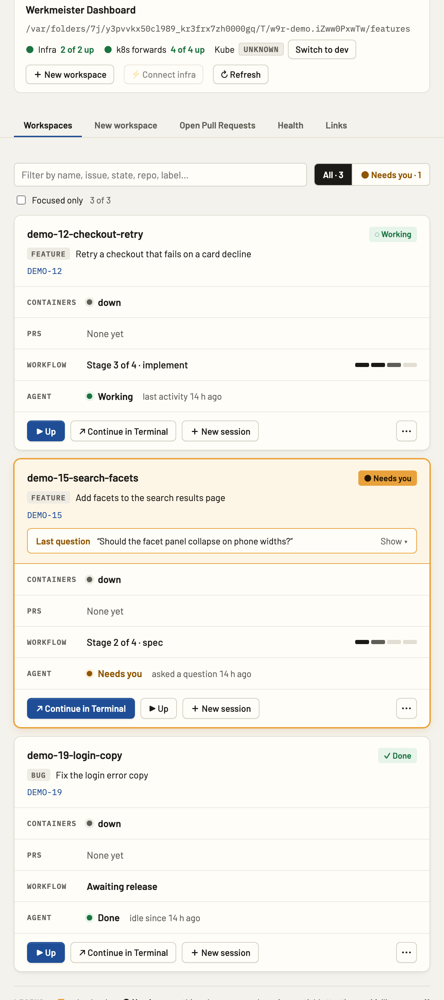
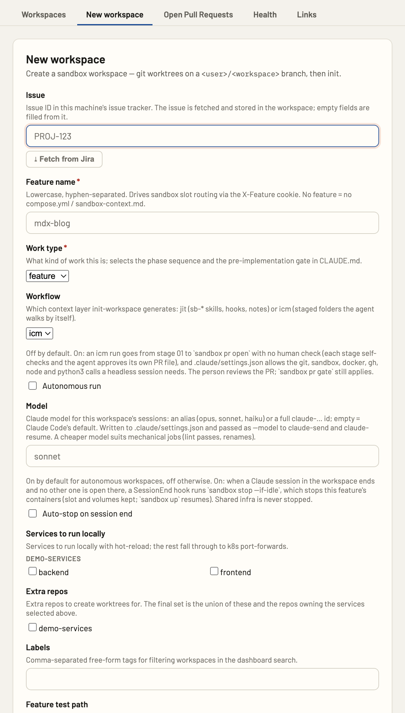
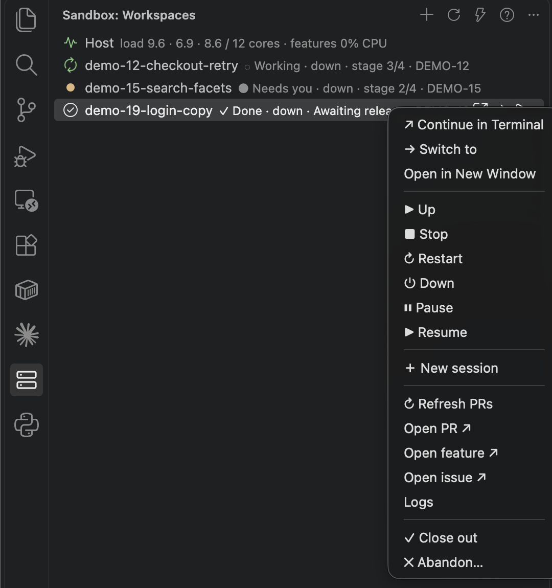
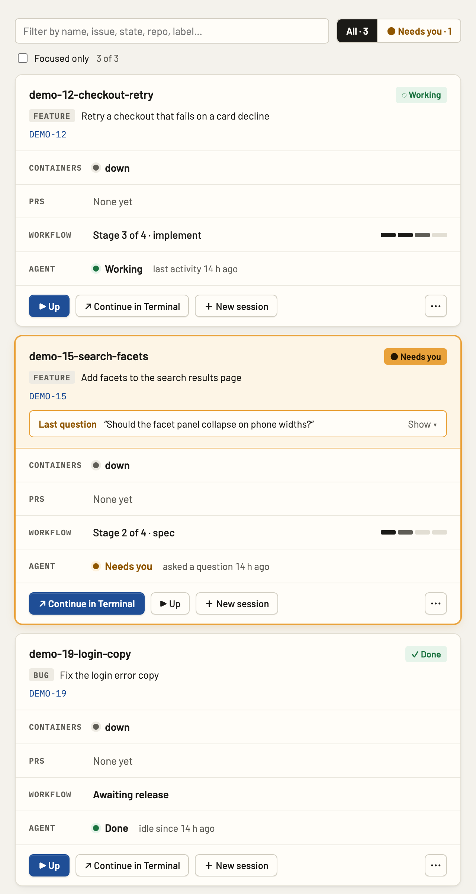
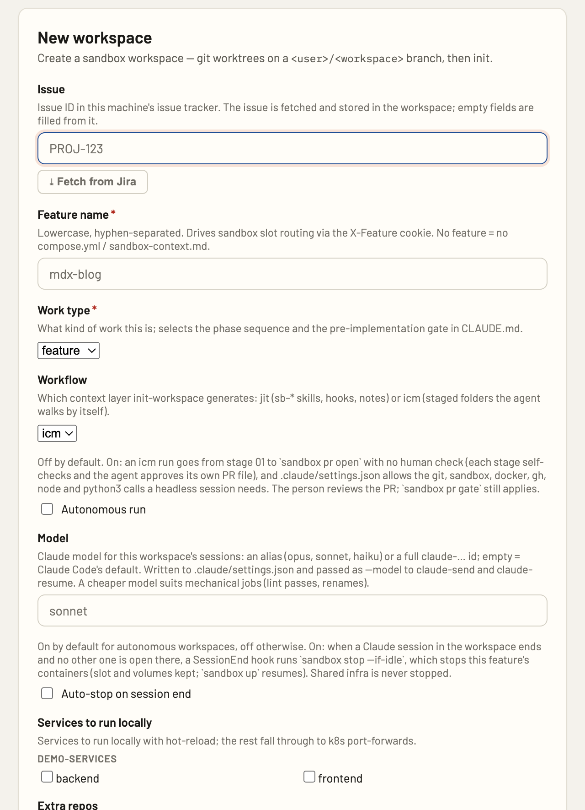

# The UIs

Werkmeister has one set of tools, the `werkmeister` MCP server, and four places
to see them. The workspace list and the create form are one implementation
(`packages/werkmeister-ui`), rendered by the browser dashboard and by Claude
Desktop; the Claude Code pane and the VS Code tree are their own compact views
of the same data. Pick the one where you already are.

Every screenshot on this page shows demo data.

## Workspaces dashboard

**What it is.** A localhost web page with one card per workspace: agent state,
containers, PRs and CI, the workflow stage, and the lifecycle buttons. Tabs for
creating a workspace, reviewing open pull requests, infra health and the
feature-selector links. Source: `apps/werkmeister-dashboard`.

**Where you open it.** `werkmeister dashboard`, or the server `werkmeister connect`
keeps on port 3001. From a Claude Code session, the `open-workspaces-ui` tool
opens the same page in your browser.

**What you can do.** Per card: Up, Stop, Pause, Resume, Restart, Down, Close
out, open in VS Code, logs and usage, and a chat panel for the workspace's
Claude session. The New workspace tab fetches the fields from the issue and
creates the workspace through the same CLI command the terminal wizard runs.

## Claude Code workspaces pane

**What it is.** A docked pane inside Claude Code with one compact card per
workspace, drawn from the same display model as the dashboard. Source:
`plugins/werkmeister/hooks/register.tsx`.

**Where you open it.** It opens by itself when a session starts in a folder of
workspaces. If it is closed, type `/workspaces`.

**What you can do.** Each card shows the agent chip (Working, Needs you, Done,
Idle), the work type and task, and containers · PRs · CI · stage. The primary
action follows the state: Up, Continue, Resume, or Close out once every PR
shipped. Stop and Pause sit beside it, and `⋯` holds the rest. ＋ New session
starts a new Claude Code session in the workspace; Continue in Desktop, VS Code
or Terminal picks up the newest one where it lives. The Create tab draws the
same form as the dashboard.

*Screenshot pending: the image above is a placeholder.*

## VS Code extension

**What it is.** A tree view in the activity bar: every workspace, then its
services with container state and Telepresence intercepts. Source:
`packages/werkmeister-vscode`.

**Where you open it.** The Werkmeister Workspaces view in VS Code's activity bar.
It polls every five seconds while visible.

**What you can do.** Up, Stop, Restart, Down, Pause and Resume on a workspace,
each run as the CLI in a terminal named after the workspace; open the feature,
the PR or the issue in the browser; refresh PRs; close out or abandon a
workspace; switch to it or open it in a new window.

## MCP App UIs in Claude Desktop

**What it is.** The workspace list and the create form rendered inline in a
Claude Desktop chat. Desktop fetches `ui://workspace/mcp-list.html` and
`ui://workspace/mcp-app.html` from the MCP server (`apps/werkmeister-mcp`); both
are the `packages/werkmeister-ui` bundle the dashboard renders, with Desktop as
the transport.

**Where you open it.** Ask Claude to list your workspaces, or to create one. A
client that cannot render MCP App UI gets a markdown table and the browser
form instead.

**What you can do.** The same list and form as the dashboard, inside the chat:
the cards' lifecycle buttons, ＋ New workspace, which swaps the list for the
form, and Create, which hands the result back to the conversation.

The two captures below are that bundle rendered outside Desktop, so the chat
around it is not shown.

