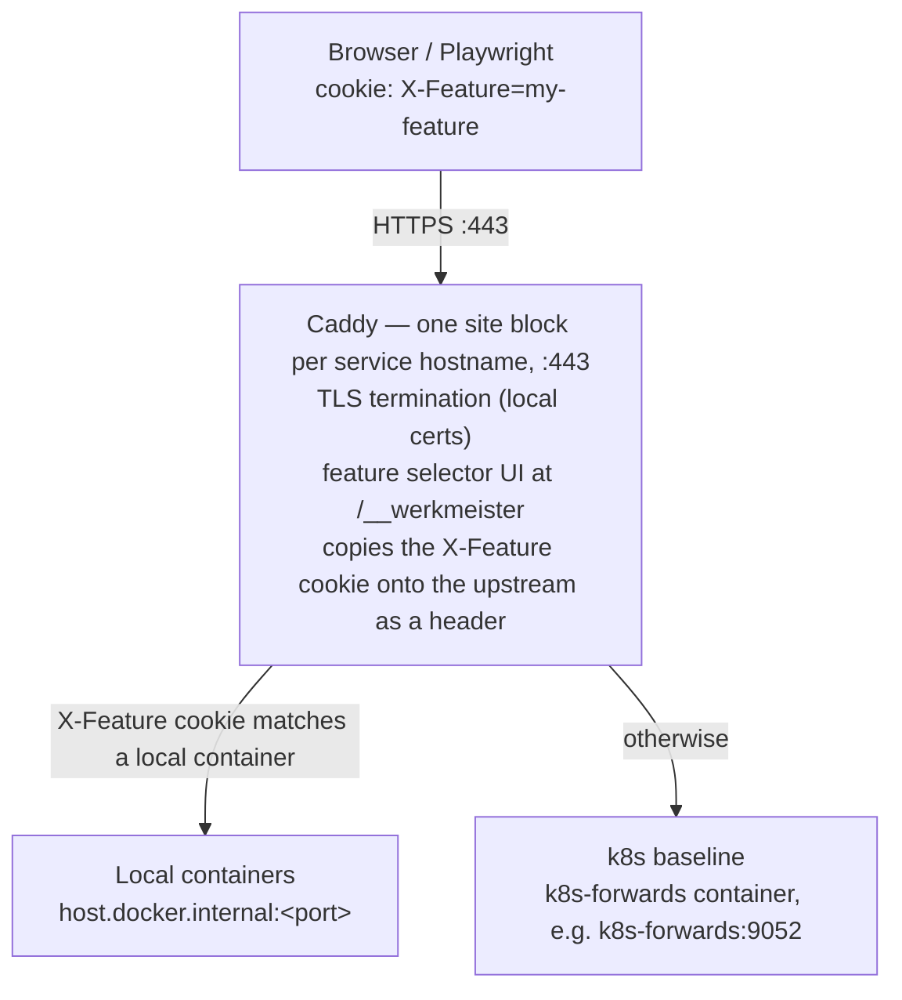

# Werkmeister Architecture

## Overview

Autonomous where it can be. Human where it must be.

One agent per ticket, each in its own git worktree and containers. Bring your harness (Claude Code, OpenCode or Codex), any OCI container manager, and your tracker (Jira, GitHub Issues, or your own).

A workspace runs only the services its ticket changes. Every other service comes from a baseline: a Kubernetes cluster, a remote host, or nothing at all (see [Topology](topology.md)). A Caddy reverse proxy routes each request to a workspace's containers or to the baseline, by the `X-Feature` cookie or header.

---

## Core Design Principles

1. **Minimal local footprint** — only run containers for services with code changes; everything else comes from the baseline (a cluster through `kubectl port-forward`, or any `host:port`).
2. **Feature isolation** — each feature gets its own Docker network, port range, and routing identity. No cross-contamination.
3. **Declared services** — the workspace's `.werkmeister/workspace.yml` lists the services that run locally; everything else comes from the baseline.
4. **Shared state** — a single shared dev database and Redis, served from the cluster through the forward table. No per-feature data isolation needed.
5. **Cookie-driven routing** — Caddy terminates each service's public hostname and resolves feature-vs-baseline per request from the `X-Feature` cookie, copying it onto the upstream call as a header so the app can read the selected feature.

---

## System Architecture

For which *machine* each of these runs on — laptop, container runtime, or a cloud
cluster — see [docs/topology.md](topology.md). This section is the request path.



<details>
<summary>Diagram source</summary>



</details>

There are two kinds of hop:

- **Container to container** (a feature's services, the k8s forwards, shared infra): Docker DNS on the `werkmeister-shared` network, e.g. `k8s-forwards:9052`.
- **Caddy to a feature's container**: `host.docker.internal:<published port>`. Caddy's container maps `host.docker.internal` to `host-gateway` in `apps/cli/infra/compose/shared-infra.yml`, so it reaches the port each feature publishes on the host.

---

## Component Details

### 1. Reverse Proxy (Caddy)

**Why Caddy**: native header/cookie matching, automatic config reload, simple config syntax, lightweight, built-in TLS support.

**Role**: Caddy is the browser-facing entry point and the only routing layer. It terminates HTTPS, serves the feature selector UI, and reverse-proxies each service's public hostname straight to its upstream — the feature's local container when one is running, otherwise the k8s baseline.

**What Caddy does**:
- Terminates HTTPS/TLS using local certificates (mounted from the directory named by `ingress.certs_dir` in `~/.werkmeister/config.yaml`).
- Serves the feature selector UI at `/__werkmeister` on every host — a static page that lets the user pick a feature and sets the `X-Feature` cookie client-side. `/__werkmeister/features.json` is matched first (a real file); any other `/__werkmeister` path returns the picker.
- Copies an `X-Feature` cookie value into an `X-Feature` header on the upstream call, so the app can read the selected feature.
- Proxies to `host.docker.internal:<port>` for a local feature container, or to `k8s-<service>:<forward_port>` for the k8s baseline.

**Caddyfile generation**: the orchestrator CLI regenerates the Caddyfile whenever a feature is started or stopped (`werkmeister infra proxy-reload`, and implicitly on `up`/`down`/`connect`). The file carries a do-not-edit header; hostnames derive from the base domains in `~/.werkmeister/config.yaml` and the `feature_router:` blocks in `services.yaml` (see `packages/werkmeister-core/src/feature_routing.ts`).

Generated by a real `werkmeister feature up --service docs-site` (feature `docs-architecture`, slot 6, so the service's port offset 6 gives host port 11606). A second running feature is kept to show how they share the hostname (two others are trimmed; the matcher number is the feature's position in the sorted list). The hostname uses the docs' example domain; on your machine it comes from `ingress.local_domain`:

```
docs-site.local.werkmeister.io {
    tls internal

    @selector_features path /__werkmeister/features.json
    handle @selector_features {
        root * /srv
        rewrite * /features.json
        file_server
    }
    @selector path /__werkmeister*
    handle @selector {
        root * /werkmeister/proxy/ui
        rewrite * /index.html
        file_server
    }

    # X-Feature=docs-architecture -> that workspace's containers.
    @feat0_docs_architecture header_regexp Cookie (?:^|;\s*)X-Feature=docs-architecture(?:\s*;|\s*$)
    handle @feat0_docs_architecture {
        reverse_proxy host.docker.internal:11606 {
            header_up X-Feature docs-architecture
        }
    }

    # X-Feature=docs-top-nav -> that workspace's containers.
    @feat3_docs_top_nav header_regexp Cookie (?:^|;\s*)X-Feature=docs-top-nav(?:\s*;|\s*$)
    handle @feat3_docs_top_nav {
        reverse_proxy host.docker.internal:11306 {
            header_up X-Feature docs-top-nav
        }
    }

    # No cookie, or one naming a feature that isn't serving this service.
    handle /* {
        reverse_proxy host.docker.internal:11606
    }
}
```

A feature only gets a `handle` for a service it runs locally, so one service can
come from a local container while its siblings still resolve to the k8s baseline.
The final `/*` handle is the no-cookie default: the service's remote (cluster)
upstream when it has one, else the first feature by name, as here. A service's
remote hostname gets its own site block with that one fixed upstream; a present
cookie is still copied onto the request as the `X-Feature` header
(`packages/werkmeister-core/src/generate.ts`).

### 2. Port Allocation Scheme

Each feature slot (1–12) gets its own 20-port range, and a service's host port is the slot's base port plus the service's `port_offset`: deterministic, no collisions. **k8s port-forwards** listen on fixed 9xxx ports inside the `k8s-forwards` container, shared by every feature and reached by Docker DNS (e.g. `k8s-forwards:9052`). Both tables live in [Configuration § Port Allocation](configuration.md#port-allocation).

**Shared infrastructure** (not k8s -- runs locally as containers):

| Service | Docker DNS | Port |
|---------|-----------|------|
| Jaeger (tracing UI), opt-in | `jaeger` | 16686 |
| RedisInsight, opt-in | `redisinsight` | 5540 |

Jaeger and RedisInsight start only when `infra.profiles` in `~/.werkmeister/config.yaml` names them (see [third-party.md](third-party.md#optional-integrations)).

Redis and Postgres themselves run in the k8s cluster and are reached through the
forward table, not as compose services. The containers listed here are defined
in `apps/cli/infra/compose/shared-infra.yml` and managed by Docker Compose.

### 3. Service Registry

A central registry, `~/.werkmeister/services.yaml`, maps repos to services and gives each one its port offset, health endpoint and k8s forward. `werkmeister machine detect` generates a repo's entry. The example and every key are in [Configuration § Configuration Files](configuration.md#configuration-files) (`~/.werkmeister/services.yaml`).

**How local services are chosen**:

1. `services:` in the workspace's `.werkmeister/workspace.yml` names the services that run locally.
2. `werkmeister workspace init` writes them to the `SERVICES=` line of the workspace `.env`.
3. `werkmeister feature up` reads that line and starts those services. An on-demand service starts only when asked: `werkmeister feature up --service <name>`.
4. Every other service comes from its k8s forward.

To change the set, edit `workspace.yml`, then run `werkmeister workspace init` and `werkmeister feature up` again.

### 4. Orchestrator CLI (`werkmeister`)

The core tool that agents and developers invoke.

```bash
# Lifecycle
werkmeister feature up <feature>         # detect services, start containers, configure proxy
werkmeister feature down <feature>        # stop containers, remove proxy routes
werkmeister feature restart <feature>     # restart feature's containers
werkmeister feature status               # show all features, their services, resource usage

# Inspection
werkmeister machine detect [repo]        # generate the repo's .werkmeister/services.yaml (--dry-run to preview)
werkmeister feature services <feature>   # list services and their endpoints for this feature
werkmeister feature logs <feature> [svc] # tail logs for a feature's service

# Manual overrides (to run a service locally: add it to .werkmeister/workspace.yml, then workspace init + feature up)
werkmeister feature drop <feature> <svc> # stop a local service, fall back to k8s

# Testing
werkmeister feature test <feature>       # run Playwright against this feature's stack

# Infrastructure
werkmeister infra up             # start shared infrastructure (k8s-forwards, caddy; jaeger, redisinsight if enabled)
werkmeister infra status         # check k8s-forwards container health
werkmeister infra proxy-reload         # regenerate Caddyfile and reload Caddy
```

**Implementation**: A TypeScript CLI that lives in the Werkmeister repo. Each command is a module in `apps/cli/src/commands/`.

### 5. Per-Feature Docker Compose Generation

`werkmeister feature up` renders the workspace's `compose.yml` (from `apps/cli/infra/templates/docker-compose.feature.yml.njk`) and its `.env` (from `env.njk`). Trimmed from the same real run, keeping the `docs-site` service:

```yaml
# Auto-generated for feature: docs-architecture
# Slot: 6 | Port range: 11600-11619
# On-demand services (the PR gate starts these): cli, docs-site, ...

name: werkmeister-docs-architecture

networks:
  feature-docs-architecture:
    name: werkmeister-docs-architecture
  shared-network:
    external: true
    name: werkmeister-shared

services:
  docs-site:
    image: node:22
    container_name: docs-architecture-docs-site
    profiles: ["on-demand"]
    labels:
      com.werkmeister.feature: "docs-architecture"
      com.werkmeister.slot: "6"
      com.werkmeister.service: "docs-site"
      com.werkmeister.role: "app"
    working_dir: /app
    volumes:
      - ~/features/sw-594-docs-architecture/werkmeister:/app   # the worktree, for hot reload
      - docs-architecture-node-modules:/app/node_modules
    ports:
      - "11606:5173"             # slot 6 base 11600 + port_offset 6
    env_file:
      - .env
      - path: .env.docs-site     # this service's secrets
        required: false
    command:
      - /bin/sh
      - -c
      - |
        cd apps/docs-site && exec pnpm exec vitepress dev . --host 0.0.0.0 --port 5173
    deploy:
      resources:
        limits:
          cpus: "1.0"
          memory: 3G
        reservations:
          memory: 768M
    depends_on:
      werkmeister-install:       # the setup service: one pnpm install per feature
        condition: service_completed_successfully
    networks:
      feature-docs-architecture:
        aliases:
          - docs-site
      shared-network:
        aliases:
          - docs-architecture-docs-site
```

**Key design choices**:
- Between containers, Docker DNS only: a feature's services, the k8s forwards and shared infra all reach each other by alias. `host.docker.internal` appears only in Caddy's hop to a published port (see [System Architecture](#system-architecture)).
- Each container joins the per-feature network (isolation, short aliases like `docs-site`) and `werkmeister-shared` (shared infra, the forwards, and a feature-prefixed alias like `docs-architecture-docs-site`).
- Each service gets `<PREFIX>_URL` / `_HOST` / `_PORT` in `.env`: a local sibling resolves to its Docker DNS alias (`http://<svc>:<port>`), any other service to its `baseline_upstream` when set, else to its forward (`http://k8s-forwards:<forward_port>`). This run had no cluster services, so its `.env` holds no service URLs: only the workspace metadata (`FEATURE`, `SERVICES`, `ISSUE_ID`, `DESCRIPTION`) and `WERKMEISTER_FEATURE`, `WERKMEISTER_SLOT`, `COMPOSE_PROJECT_NAME`.
- The worktree is volume-mounted for hot reload; `node_modules` is a per-feature named volume filled by the setup service.
- Containers carry `com.werkmeister.*` labels; the slot label is how the CLI knows which slot a feature holds.

### 6. GraphQL Federation (optional)

Applies only when the registry has a service with a GraphQL type (`graphql-subgraph`, `graphql`, `subgraph`, `federation`). Without one, no supergraph config is generated.

The gateway needs to know where each subgraph lives. Since subgraph locations vary per feature (some local, some k8s), the config must be per-feature.

**Approach**: `werkmeister feature up` renders `<workspace>/.werkmeister/supergraph-config.yml` from `apps/cli/infra/templates/supergraph-config.yml.njk`, one entry per `graphql-subgraph` service. A local subgraph's `routing_url` is its alias on the per-feature network; any other goes through the shared `k8s-forwards` container. The path is `/graphql` unless the service sets `graphql_path:`.

A gateway in the cluster can't reach a feature's local subgraphs, so a feature with a local subgraph runs the gateway locally too.

### 7. k8s Port-Forward Manager (Containerized)

All k8s port-forwards run inside a single Docker container (`k8s-forwards`) rather than as host-level background processes. This simplifies lifecycle management, networking, and health monitoring.

**Container details**:
- Built from `apps/cli/infra/compose/k8s-port-forward/Dockerfile` (based on a digest-pinned `alpine`).
- Installs `kubectl`, `bash`, `netcat-openbsd`, `redis` and `postgresql-client` for port-forwarding and health probes. It ships no cloud-provider auth plugin: OrbStack's cluster authenticates via the client cert embedded in the mounted kubeconfig; clusters that need an exec plugin (EKS, GKE, AKS) are covered in [topology.md](topology.md).
- Entrypoint script (`apps/cli/infra/compose/k8s-port-forward/entrypoint.sh`) runs all port-forwards as background processes with auto-restart loops.
- Mounts `~/.kube` (read-only) and the generated kubeconfig for `kubectl` authentication.

**Networking**:
- Connected to the `werkmeister-shared` Docker network.
- Registers DNS aliases for each forwarded service (e.g., `k8s-backend`, `k8s-frontend`, `k8s-redis`, `k8s-postgres`).
- The primary alias `k8s-forwards` is the canonical name used by other containers.
- Each forward listens on `0.0.0.0:<listen_port>` so it is reachable from any container on the shared network.

**Port mappings**: listen port, k8s service, namespace and remote port for each forward are in [Configuration § k8s Forward Ports](configuration.md#k8s-forward-ports).

**Health checks**: Docker Compose healthcheck runs `/usr/local/bin/probe.sh` (`apps/cli/infra/compose/k8s-port-forward/probe.sh`). The container reports healthy only when every forward in the table answers its protocol probe. Other containers (e.g., `redisinsight`) use `depends_on: k8s-forwards: condition: service_started` to wait.

**Lifecycle**: Managed entirely by Docker Compose. Auto-restarts on failure (`restart: unless-stopped`). Logs are accessible via `docker logs w9r-k8s-forwards`. The `werkmeister infra status` command checks the container's health status.

### 8. Playwright Integration

Each feature can run its Playwright suite against its own stack. Playwright hits the same service URL every feature uses; only the `X-Feature` value differs.

**Browser traffic**: Caddy copies the `X-Feature` cookie into an `X-Feature` header on every request routed to a feature, and on hosts with no running feature, so apps need no code change to carry the feature. A request whose cookie names a feature that doesn't run this service falls through to the default upstream without the header, and a call a service makes itself, without going through Caddy, doesn't carry it.

**Test runs**: `werkmeister feature test <feature>` looks for a `playwright.config.*` in the workspace root, then in each repo worktree. With none, it runs nothing and lists each service's test command instead. With one, it sets `WERKMEISTER_FEATURE` and, when the feature has a slot, `WERKMEISTER_SLOT`, then runs `npx playwright test` from that directory. `werkmeister feature test --scaffold` writes a starter config that sends the feature as a header:

```javascript
// playwright.config.ts, as --scaffold writes it (trimmed)
export default defineConfig({
  use: {
    // Filled by `werkmeister feature test --scaffold` from the configured feature ingress.
    baseURL: 'https://<service>.<base domain>',
    ignoreHTTPSErrors: true,
    extraHTTPHeaders: {
      'X-Feature': process.env.WERKMEISTER_FEATURE || '',
    },
  },
});
```

See [`werkmeister feature test`](cli-reference.md#werkmeister-feature-test) for its flags.

---

## Routing applies only to front-door services

Caddy routing, the `X-Feature` cookie, the proxy health checks and the Playwright feature test apply only to services with a `feature_router:` block. Libraries, CLIs and editor extensions are not reached by URL, so none of that exercises them. `.werkmeister/werkmeister-context.md` always carries a "How to validate" table with each of the workspace's services and its test command, plus the service's `validate:` text (or its archetype's). It emits the routing, Caddy and health-check sections only when the workspace has a URL-addressed service. `werkmeister feature test` runs Playwright only when the workspace has a `playwright.config.*`. `test:` is the command tooling runs (the implement stage, the PR gate); `validate:` is the hands-on check an agent or person performs, recorded as the exercise table the gate requires. See [Test commands and validation guidance](registry-fragments.md#test-commands-and-validation-guidance).

## Directory Structure

```
~/werkmeister/                          # werkmeister repo
├── apps/cli/werkmeister                 # CLI entrypoint (bash wrapper -> node)
├── apps/cli/src/               # CLI source
│   ├── main.ts
│   └── commands/                       # one module per command (up.ts, down.ts, ...)
├── apps/cli/infra/compose/             # Docker Compose files
│   ├── shared-infra.yml                # Shared infrastructure (k8s-forwards, caddy,
│   │                                   #   opt-in jaeger, redisinsight)
│   └── k8s-port-forward/               # Containerized k8s port-forwards
│       ├── Dockerfile                  # alpine, digest-pinned: kubectl + probe clients
│       ├── entrypoint.sh              # Port-forward supervisor script
│       └── probe.sh                    # Healthcheck
├── apps/cli/infra/templates/
│   ├── docker-compose.feature.yml.njk  # nunjucks template for per-feature compose
│   ├── Caddyfile.njk                   # Template for proxy config
│   ├── env.njk                         # Template for the workspace .env
│   └── supergraph-config.yml.njk       # Template for the optional GraphQL gateway
├── apps/cli/infra/proxy/ui/            # Feature selector web UI
│   └── index.html
└── docs/
    ├── users-guide.md, concepts.md, cli-reference.md, configuration.md
    └── known-issues.md

~/.werkmeister/                         # machine config + generated state
├── config.yaml, services.yaml, ports.yaml
└── infra/proxy/
    ├── Caddyfile                       # Generated — do not edit
    └── features.json                   # Generated feature list for UI

~/workspace/                            # workspaces root (paths.workspaces_root)
├── payment-refactor/
│   ├── compose.yml                     # Generated per-feature compose stack
│   ├── .env                            # Generated resolved env vars
│   ├── .werkmeister/
│   │   ├── workspace.yml               # The services this workspace runs locally
│   │   └── supergraph-config.yml       # Generated only when a GraphQL subgraph exists
│   ├── demo-services/                  # git worktree
│   └── api/                            # git worktree
├── auth-redesign/
│   ├── compose.yml
│   ├── .env
│   ├── .werkmeister/
│   │   └── supergraph-config.yml
│   ├── werkmeister/
│   └── standalone-auth/
└── ...
```

---

## Lifecycle: `werkmeister feature up`

What `feature up` does, step by step (slot allocation, the budget queue, file generation, the forward check, compose up, the Caddy reload), is in [CLI reference § `werkmeister feature up`](cli-reference.md#werkmeister-feature-up), generated from the command's own help.

---

## Resource Estimation

There are two budgets: the memory you gave Docker, where containers live, and the rest of the machine, where agents, browsers and your editor run. The per-item numbers, a worked example and the measured runs are in [Docker resources § Sizing a machine](docker-resource-optimization.md#sizing-a-machine).

---

## Agent Integration

### Claude Code Agent Integration

Each Claude Code agent operates in its own workspace and can invoke `werkmeister` commands:

```bash
# Agent starting work on a feature
werkmeister feature up payment-refactor

# Agent wants to check its work
werkmeister feature test payment-refactor

# Agent adds a service it now needs (after listing graphql-orders in .werkmeister/workspace.yml)
werkmeister workspace init
werkmeister feature up payment-refactor

# Agent checks what's running
werkmeister feature status
```
