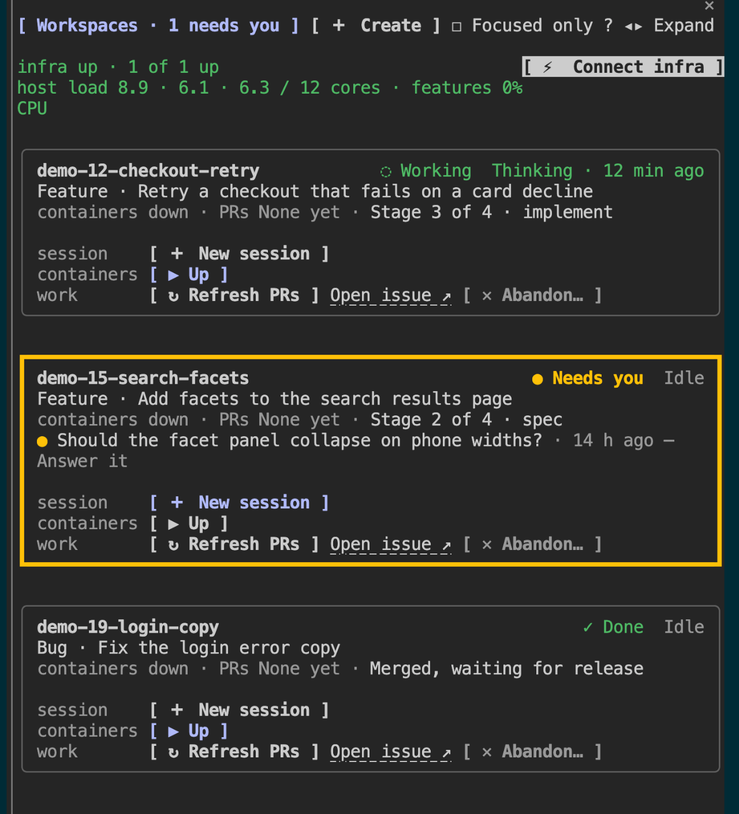

# werkmeister

The Claude Code plugin for Werkmeister: a pane of your workspaces, a band in each workspace session, the diagnostic and lifecycle skills, and the `werkmeister` MCP server.

> Paths: `~/.werkmeister/` and a workspace's `.werkmeister/` are the current names. A machine or workspace set up before the rename moves its old directories with `werkmeister machine migrate`.

## The `/workspaces` pane



*Screenshot pending: the image above is a placeholder.*

A docked pane with one compact card per workspace. It opens by itself when an interactive session starts in a folder of workspaces (one whose child holds `.werkmeister/workspace.yml`, e.g. `~/features`); type `/workspaces` to open it again.

- **Line 1:** the name, the agent chip (`◌ Working` · `● Needs you` · `✓ Done` · `Idle`), and `⚙ Auto` for an autonomous run.
- **Line 2:** work type · task from `workspace.yml`.
- **Line 3:** `containers 2 of 3 up · PRs repo#12 Open · CI running · stage 4/5 implement`. The last part is the ICM stage, the JIT phase, or the lifecycle step (`Ready to close out`, `Awaiting release`; see [Workspace lifecycle](../../docs/workspace-lifecycle.md)).

A Needs you card quotes the question its agent asked, and is the only card with an amber border. `?` beside the tabs shows the legend.

The buttons sit in three rows by what they act on. Those that don't apply are hidden, and the primary action for the state (▶ Resume while paused, Continue, ✓ Close out once shipped, or ▶ Up while nothing runs) is highlighted.

| Row | Buttons |
|---|---|
| session | ⇆ Open beside or Continue (in VS Code or Terminal, where the newest session lives), ＋ New session, 📌 Pin |
| containers | ▶ Resume or ▶ Up, ■ Stop, ⏸ Pause, ↻ Restart, ⏻ Down, then Logs and Open feature ↗ while they run |
| work | ↻ Refresh PRs (`werkmeister pr status`, also the retry for `PRs unavailable`), Open issue ↗, ✓ Close out, ✕ Abandon… |

✓ Close out and ✕ Abandon… run `werkmeister workspace close`; each confirms in the card first, Abandon asks for the reason, and both archive the workspace's desktop sessions and list terminal sessions still open there to `/exit`.

The **＋ Create** tab draws the same workspace form as the browser dashboard, with a button that fills empty fields from the issue, and creates the workspace directly. On the Workspaces tab, ☐ Focused only shows the workspaces whose `labels` include `focus`. The `workspaces_pane_fill_create_form` tool lets Claude fill the form from your prompt; it never creates the workspace.

## The workspace band

In a session inside a workspace (its folder or one below holds `.werkmeister/workspace.yml`), a band above the prompt draws that workspace's card without its buttons: name and chips, work type · task, the containers · PRs · workflow line, resources, a crash loop, and the question a Needs you agent asked. Outside a workspace it draws nothing.

## Skills

Skills are namespaced by the plugin: `/werkmeister:diagnose`, `/werkmeister:workspace`, …

### Diagnostics & operations
| Skill | What it does |
|-------|--------------|
| `status` | Comprehensive health overview of the whole werkmeister setup (containers, networks, proxy). |
| `diagnose` | Full-stack health checks across containers, networking, Caddy routing, and connectivity. |
| `routing-test` | Trace a single URL through the routing chain to find where it breaks. |
| `caddy-reload` | Validate, reload, and smoke-test the Caddy proxy config safely. |

### Workspace lifecycle
| Skill | What it does |
|-------|--------------|
| `setup` | First run on a new machine: checks the prerequisites, runs machine setup with you, registers your repos and creates your first workspace. |
| `workspace` | Create a brand-new workspace (git worktrees + init) through the create form; falls back to the CLI. |
| `feature-test` | Start a feature environment and open a headed Playwright browser for interactive testing. |
| `starting-prompt` | Run the `starting_prompt` defined in the workspace's `.werkmeister/workspace.yml`. |
| `install-check` | Check (and `--fix`) that the global `werkmeister`/`w9r`, its MCP server and this plugin all run from the repo checkout. The plugin also runs it at every interactive session start. |
| `check-in` | From the root session: cycle the workspaces, show each one waiting on a person as a card, and relay the answer. An approval goes in as the gate file's own status flip with the check-in note, so the workspace acts on it with no second prompt. |
| `postmortem` | Before close-out: gather every problem in the run, agree with the person what changes so it doesn't recur, write `postmortem.md` and act on each change ([Workspace lifecycle § Post-mortem](../../docs/workspace-lifecycle.md#post-mortem)). |

## Bundled MCP server (`werkmeister`)

The plugin's [`.mcp.json`](./.mcp.json) wires up the one werkmeister MCP server
(`werkmeister internal mcp`) with every tool: workspace create/manage and lifecycle, PR review,
issue lookups, k8s/kube health, and a Claude session bridge. Each client gets the same form, with
the UI its host can draw:

| Surface | How it connects | UI |
|---------|-----------------|----|
| **Claude Desktop** | `claude_desktop_config.json` (Desktop doesn't install plugins) | Inline MCP App (`ui://`): create form + workspace dashboard |
| **Claude Code CLI / VS Code** | this plugin's `.mcp.json` | Localhost browser: dashboard (`open-workspaces-ui`) + blocking create form |

Every tool also returns markdown, so any host works. Call the create tool directly:
`mcp__plugin_werkmeister_werkmeister__create-workspace-form` (optionally
`{ "issue": "<issue ID>" }`). Full tool table in the
[server README](../../apps/werkmeister-mcp/README.md).

## Install

Needs the `w9r` CLI (package `werkmeister` 0.14 or later) on `PATH`, and Docker running.
Issues come from the tracker picked in `werkmeister machine setup`.

This repo doubles as a plugin marketplace. From any Claude Code session (installs at user scope,
so the skills and MCP server are available in every session, not just inside this repo):

```
/plugin marketplace add jbbz-sandbox/werkmeister
/plugin install werkmeister@werkmeister
```

To work on the plugin from a checkout, see [Contributing](../../docs/contributing.md#the-claude-code-plugin-from-a-checkout).

### Register on Claude Desktop
Plugins don't install in Desktop, so add the same server to
`~/Library/Application Support/Claude/claude_desktop_config.json`:

```json
{ "mcpServers": { "werkmeister": { "command": "werkmeister", "args": ["internal", "mcp"] } } }
```
